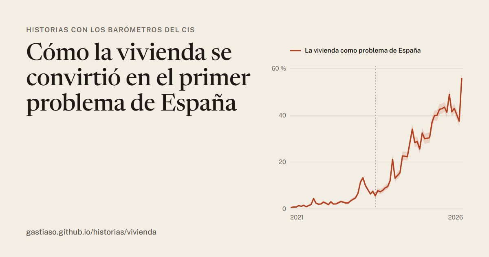
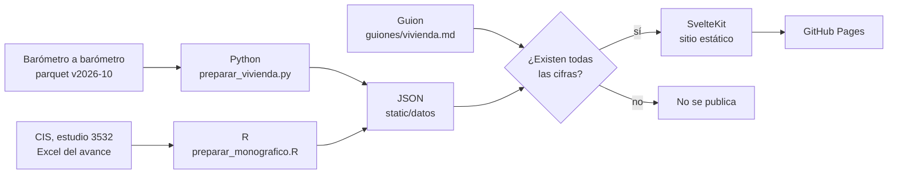

# Historias con los barómetros del CIS

**Historias para leer con scroll, contadas con los barómetros del CIS: el gráfico cambia mientras avanza el texto.**

### → [gastiaso.github.io/historias](https://gastiaso.github.io/historias/)

[](https://gastiaso.github.io/historias/vivienda/)

Cada mes, el Centro de Investigaciones Sociológicas (CIS) pregunta a unas 4000 personas cuáles son los principales problemas de España y cuáles les afectan personalmente. [*Barómetro a barómetro*](https://gastiaso.github.io/barometros/) reúne esos barómetros para que cada cual construya sus series. Este sitio elige un tema y lo explora a través de los datos.

## Historias

| Historia | Datos | Publicada |
|---|---|---|
| [**Cómo la vivienda se convirtió en el primer problema de España**](https://gastiaso.github.io/historias/vivienda/) | 64 barómetros, de enero de 2021 a octubre de 2026 (264.081 entrevistas, edición [`v2026-10`](https://github.com/gastiaso/barometros/releases/tag/v2026-10)), y el *Barómetro de Vivienda 2026* (estudio 3532, avance de resultados) | 7 de noviembre de 2026 |

### La vivienda

En noviembre de 2023, el 5,6 % de los entrevistados citaba la vivienda entre los problemas de España. En el último año, la media ha sido del 43,6 %, y en los últimos 21 barómetros ha sido siempre el primer problema. La historia sigue esa subida y la descompone:

- **Por edad.** Como problema personal la cita el 51 % de quienes tienen de 18 a 24 años y el 13 % de los mayores de 65. Como problema de España, todas las edades están entre el 40 y el 49 %. La sufren los jóvenes; la ven todos.
- **Por ideología.** Como problema del país, el 56 % en la izquierda y el 23 % en la derecha, una distancia que se mantiene dentro de cada grupo de edad.
- **El salto de octubre de 2026.** Fueron 18,2 puntos en un mes, pero ese cuestionario preguntaba por vivienda antes de la pregunta de problemas. Mezcla noticia y cuestionario, y por eso no es el titular.
- **La encuesta de vivienda de junio de 2026.** Qué significa que la vivienda te perjudique: en los últimos cinco años, el 31 % de quienes tienen de 18 a 34 años ha necesitado dinero de su familia para pagar el alquiler o la hipoteca. También, quién pide que el Estado intervenga y qué apoyo tienen diez medidas, cada una con su desglose por edad, sexo, ideología, recuerdo de voto, estudios, ocupación, clase social, tamaño del municipio y religiosidad.


## Datos

| Fichero | Contenido |
|---|---|
| [`serie.json`](https://gastiaso.github.io/historias/datos/vivienda/serie.json) | La vivienda como problema de España y como problema personal, mes a mes, con margen, entrevistas y puesto entre los problemas. También las medias anuales, las rupturas y los avisos de cuestionario |
| [`grupos.json`](https://gastiaso.github.io/historias/datos/vivienda/grupos.json) | El último año por edad, ideología y sexo, y por sexo dentro de cada edad |
| [`puntos.json`](https://gastiaso.github.io/historias/datos/vivienda/puntos.json) | La muestra de la nube: 320 entrevistas por barómetro, sin ponderar, elegidas con semilla fija |
| [`monografico.json`](https://gastiaso.github.io/historias/datos/vivienda/monografico.json) | *Barómetro de Vivienda 2026*: siete indicadores, 18 situaciones vividas y diez medidas, por los nueve cruces del CIS |

Se pueden descargar y reutilizar con licencia [CC BY 4.0](https://creativecommons.org/licenses/by/4.0/deed.es), citando la autoría y, siempre, la fuente original (CIS).

**Cómo se mide en los barómetros.** Porcentaje de entrevistados que citan la vivienda entre sus hasta tres menciones, con el peso del CIS. La base es quien da una primera mención (también NS/NC); el margen es el intervalo de Wilson al 95 % sobre el tamaño efectivo. Es el mismo método que *Barómetro a barómetro*, y coincide con lo publicado por el CIS (por ejemplo, el 55,7 % de octubre de 2026).

**Cómo se mide en el monográfico.** Sin microdatos publicados, los conteos ponderados se reconstruyen a partir de las tabulaciones del avance (porcentaje por base de cada columna), así que agrupar edades o tramos de ideología es exacto. El efecto de diseño se estima a partir de la sobremuestra urbana (1,347; el método está al principio de [`preparar_monografico.R`](datos/preparar_monografico.R)).

## Cómo funciona



Los datos se preparan en local y se guardan en el repositorio, anclados a su edición. GitHub Actions no los recalcula: comprueba, construye y publica ([`publicar.yml`](.github/workflows/publicar.yml)).

- [`src/lib/motor/Historia.svelte`](src/lib/motor/Historia.svelte): el motor. Gráfico fijo a pantalla completa (en escritorio, a la derecha) y pasos del guion que suben por encima y cambian el estado del gráfico al cruzar una línea de la pantalla.
- [`src/lib/vivienda/`](src/lib/vivienda/): los gráficos de la vivienda (la nube en canvas; la serie, los grupos y las medidas en SVG), sus estados, sus cifras y el panel de desglose.
- [`src/lib/guion.js`](src/lib/guion.js): lee el guion y rellena las cifras.
- [`src/lib/motor/margenes.js`](src/lib/motor/margenes.js): los globos con el margen, el % y las entrevistas de cada dato.

Hecho con [SvelteKit](https://svelte.dev/docs/kit) y `adapter-static`, sin plantillas de terceros.

## Escribir una historia

Todo el texto de una historia está en un solo archivo, [`guiones/vivienda.md`](guiones/vivienda.md), con las instrucciones al principio. En resumen:

- cada `## nombre` es un paso, y el nombre dice qué muestra el gráfico (`nube`, `linea`, `edad`…);
- las cifras se escriben entre llaves: `{esp_media}` da «43,6 %», `{esp_media:0}` da «44 %» y `{esp_media:margen}` da «42,9–44,2 %»;
- el apartado final `## rotulos` lleva los textos cortos de los gráficos (leyendas, notas, fuente).

Para verlo mientras se escribe:

```sh
npm install
npm run dev
```

y abrir <http://localhost:5173/historias/vivienda/>. La página se recarga al guardar el guion. Al pie aparece la lista de todas las cifras disponibles, con su valor y qué son; arriba, los porcentajes escritos a mano. Si un nombre no existe, la página dice cuál y sugiere el más parecido.

## Preparar los datos

Desde la raíz del repositorio:

```sh
python datos/preparar_vivienda.py RUTA/barometros_armonizados_v2026-10.parquet
Rscript datos/preparar_monografico.R RUTA/3532-multi_A.xlsx RUTA/3532-multi01_A.xlsx
```

- El primero usa pandas y pyarrow, y lee el parquet de la [versión `v2026-10`](https://github.com/gastiaso/barometros/releases/tag/v2026-10) de *Barómetro a barómetro*. Escribe `serie.json`, `grupos.json` y `puntos.json` en `static/datos/vivienda/`.
- El segundo usa readxl y jsonlite, y lee las tabulaciones del avance de resultados del estudio 3532 en la [web del CIS](https://www.cis.es/es/w/avance-de-resultados-del-estudio-3532-bar%C3%B3metro-de-vivienda-2026-). El segundo Excel, el de las grandes ciudades, es opcional. Escribe `monografico.json`.

## Compartir

El nombre, la descripción y la dirección del sitio están en [`src/lib/sitio.js`](src/lib/sitio.js). Cada página lleva sus etiquetas para compartir (título, descripción e imagen), y la portada toma el título y la entradilla de cada historia de su guion.

Las imágenes para compartir (1200 × 630) están en `static/compartir/` y se generan con los datos, el título del guion y el nombre del sitio:

```sh
npm run compartir
```

Usan Edge o Chrome sin ventana; si no están en su sitio habitual, la ruta se indica con la variable `NAVEGADOR`. Hay que volver a generarlas si cambia el título del guion, el nombre del sitio o los datos.

## Construir y publicar

`npm run build` genera el sitio estático en `build/`. Si el guion cita una cifra que no existe, la construcción se detiene con el mismo mensaje que da la página en `npm run dev`.

El workflow [`publicar.yml`](.github/workflows/publicar.yml) hace lo mismo en GitHub. En cada pull request comprueba y construye el sitio, sin publicarlo. Al fusionar en `main`, lo publica en GitHub Pages. Requiere que el repositorio tenga Pages con origen «GitHub Actions» (Settings → Pages).

## Limitaciones

- **El monográfico de vivienda es un avance.** Sus cifras salen de las tabulaciones publicadas el 8 de octubre de 2026, no de microdatos: los márgenes son aproximados, y los resultados definitivos pueden corregirlas ligeramente. La historia no cambia con ellos: forma parte de la edición `v2026-10`.
- **Las dos encuestas no miden lo mismo.** Citar la vivienda sin que nadie la sugiera, como en los barómetros, no es lo mismo que responder cuando te preguntan por ella, como en el monográfico (al 87 % le preocupa mucho o bastante).
- **La nube de entrevistas va sin ponderar.** Desde noviembre de 2023 exagera la vivienda: de media, unos 2 puntos como problema personal y 4 como problema de España. Por eso lleva el rótulo «sin ponderar».
- **Algunas preguntas empujan.** La de la intervención del Estado la enfrenta a dejar el precio a «la ley de la oferta y la demanda», una formulación que puede inclinar hacia la primera opción. En baterías de medidas mucha gente tiende a decir que sí a todo, y por eso las medidas se ordenan por saldo (a favor menos en contra).
- **Nada de causas.** Las historias describen quién cita la vivienda y cuándo. No explican por qué.

Las conclusiones son provisionales y se revisan a medida que hay más datos.

## Cómo citar

> Astiaso Llamazares, G. (2026). *Cómo la vivienda se convirtió en el primer problema de España*. Historias con los barómetros del CIS. https://gastiaso.github.io/historias/vivienda/. CC BY 4.0. Origen de los datos: Centro de Investigaciones Sociológicas (CIS), barómetros mensuales (edición `v2026-10` de *Barómetro a barómetro*) y *Barómetro de Vivienda 2026* (estudio 3532, avance de resultados).

Añade la fecha de consulta.

## Fuente y condiciones

**Origen de los datos: Centro de Investigaciones Sociológicas (CIS)**, barómetros mensuales y *Barómetro de Vivienda 2026* (estudio 3532). Elaboración propia.

Los datos se reutilizan según las [condiciones generales del CIS](https://www.cis.es/es/aviso-legal): citar la fuente, mencionar la fecha de actualización y no desvirtuar el sentido de la información. Este proyecto no está patrocinado por el CIS ni cuenta con su respaldo.

## Licencias

- **Código:** [MIT](LICENSE). Se puede reutilizar con cualquier fin conservando el aviso de autoría.
- **Textos de las historias, gráficos, imágenes y datos preparados:** [CC BY 4.0](https://creativecommons.org/licenses/by/4.0/deed.es). Se pueden reutilizar con cualquier fin citando la autoría.
- **Datos originales del CIS:** condiciones de reutilización del CIS.
- **Fuentes:** Newsreader y Public Sans, con licencia SIL Open Font License 1.1, servidas desde el propio sitio.

Detalle y fórmula de cita en [`LICENCIA-DATOS.md`](LICENCIA-DATOS.md).

## Relacionado

- [*Barómetro a barómetro*](https://gastiaso.github.io/barometros/) ([repositorio](https://github.com/gastiaso/barometros)): las series de los barómetros del CIS desde 2021, armonizadas desde los microdatos. De ahí salen los datos de estas historias, y cada historia acaba en ella.
